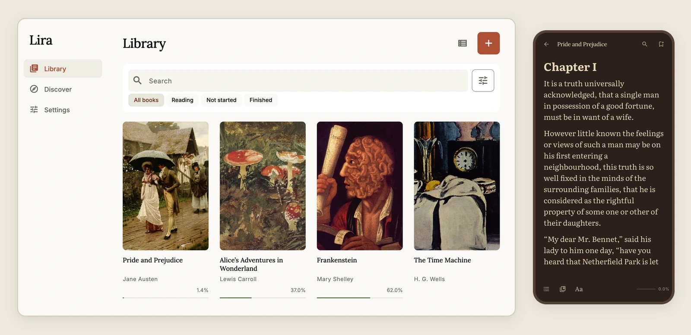
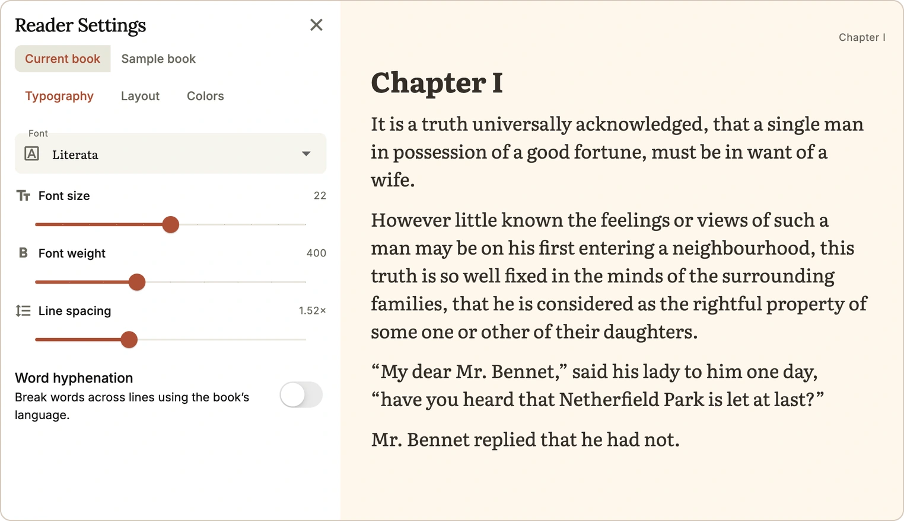
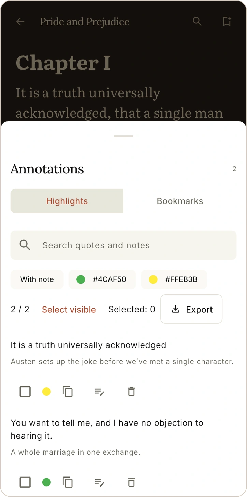

# Lira

**A free, offline EPUB and PDF reader. No account required.**

Build a library from the books you already have. Set the type, spacing, and colors the way you like them. Save the passages you want to come back to.

**[Download Lira →](https://github.com/0x0FACED/lira/releases/latest)** · [Installation](#get-lira) · [User guide](docs/user-guide.md)

Android · iOS · Windows · macOS · Linux



## A library you can take offline

Import your EPUBs and PDFs and pick up where you left off, even without a connection. Browse covers or switch to a compact list. Sort by progress, filter by reading status, or use genres and tags to find the right book. Missing a cover? Look up the edition in Open Library and choose what to keep.

Pair two devices on the same local network with a [one-time QR invitation](docs/user-guide.md#local-qr-synchronization) to exchange books, reading progress, highlights, notes, and bookmarks. Sync is manual and needs no cloud service.

## Make the page yours

Change the EPUB font, line spacing, margins, and colors while you read. Turn pages, scroll, or open a two-page spread on a wider screen. Switch from a paper palette to a warm evening one, or set your own colors. PDFs keep the original layout.



## Keep the good parts

Highlight a line, add a note, or bookmark a page. Search saved quotes and notes, then export the ones you want as Markdown or plain text. To find a passage you haven’t saved, search inside an EPUB or a text-based PDF without a connection.

<p align="center">
  <a href="docs/images/annotations.webp"></a>
</p>

## Find your next read

**Discover** brings book catalogs, articles, and the official RFC index into one place. Choose your sources, then read or save articles and RFCs as offline EPUBs. Online sources may require internet access, sign-in, or verification; imported files don't.

## Get Lira

Open the **[latest GitHub release](https://github.com/0x0FACED/lira/releases/latest)** and look for the file ending in:

| Platform | File | Installation |
| --- | --- | --- |
| Android | `-android.apk` | Install the APK. Android may ask you to allow installs from your browser or file manager. |
| iOS | `-ios.ipa` | The IPA is unsigned. Sign it with AltStore, Sideloadly, or another signing tool before installing. |
| Windows | `-windows.zip` | Extract the ZIP and run `lira.exe`. |
| macOS | `-macos.dmg` | Requires macOS 11+. The app is not Developer ID-signed or notarized; Gatekeeper may require approval in Privacy & Security. |
| Linux | `-linux.zip` | Extract the ZIP and run `lira` on a GTK 3 desktop. |

Choose **Continue to library**, then **+** to import an EPUB or PDF. No book handy? Try **Settings → Customize reader** with the built-in sample. The interface is available in English and Russian.

## Build from source

Use Flutter **3.41.6** (the CI version) and the native tooling for your target platform.

```bash
git clone https://github.com/0x0FACED/lira.git
cd lira
flutter pub get
flutter run
```

[Reader architecture](lib/features/reader/README.md) · [Release workflow](.github/workflows/build.yml) · [Changelog](CHANGELOG.md) · [Report an issue](https://github.com/0x0FACED/lira/issues/new)

<sub>Screenshots show the current app with public-domain text and cover artwork from <a href="https://standardebooks.org/">Standard Ebooks</a>.</sub>
