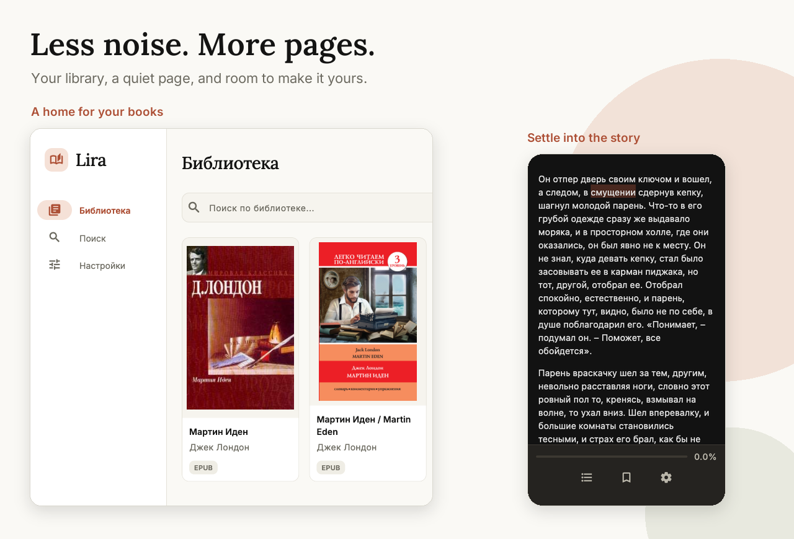
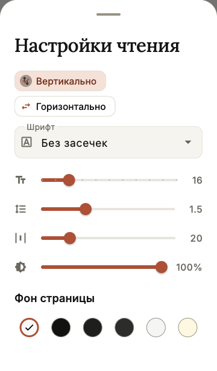

<div align="center">


# Lira

### Your books. Your pace. Your space.

A free EPUB and PDF reader for the books you love and the ones you have yet to discover.<br />
Read offline, keep the lines that matter, and make every page feel like yours.

**Android · iOS · Windows · macOS · Linux**

<a href="https://github.com/0x0FACED/lira/releases/latest"></a>

[Why Lira](#why-lira) · [Choose your download](#get-lira) · [Getting started](#your-first-chapter) · [Release notes](CHANGELOG.md)

</div>

<p align="center">
  
</p>

<p align="center"><sub>Real app previews, cropped and arranged for this image. Shown in Russian; English is available too.</sub></p>

## Why Lira

A good reader should make it easier to stay with a book. Lira keeps your library, your reading tools, and your next discoveries close—without making the interface the main event.

- **Bring the books you already have.** Import EPUB and PDF files from your device and give them a home on your own shelf.
- **Leave the connection behind.** Once a book is on your device, you can read it offline. Your progress, highlights, notes, and bookmarks are saved locally.
- **Keep more than your place.** Bookmark a reading position, highlight a passage, add a thought, and jump back when you need it. Highlights and bookmarks have separate tabs. Close the book and return to where you left off.
- **Make the page yours.** For EPUBs, adjust the font, text size, line spacing, margins, and reading background. Scroll vertically, turn pages horizontally, or use a two-page spread when there is room.
- **Read both formats their own way.** EPUB text adapts to your page; PDFs keep their original layout. Both share the same library and reading tools.
- **Follow your curiosity.** Search Anna's Archive and Z-Library, filter results, and download books without leaving the app. Source availability and access requirements vary.

Warm light and dark themes, layouts for phones and desktops, and English and Russian interfaces make Lira feel at home wherever you like to read.

<details>
<summary><strong>A closer look at the EPUB reading controls</strong></summary>
<br />
<p align="center">
  
</p>
</details>

## Get Lira

**[Download the latest release](https://github.com/0x0FACED/lira/releases/latest)** and choose the file for your device:

| Your device | Download | Before you open it |
| --- | --- | --- |
| **Android** | [APK](https://github.com/0x0FACED/lira/releases/latest/download/app-release.apk) | Install the APK directly on your device. You may need to allow installation from your browser or file manager. |
| **Windows** | [Windows ZIP](https://github.com/0x0FACED/lira/releases/latest/download/lira-windows.zip) | Extract the archive and launch the app. |
| **macOS** | [macOS DMG](https://github.com/0x0FACED/lira/releases/latest/download/Lira.dmg) | The app is not Developer ID-signed or notarized. Gatekeeper may require you to allow it in Privacy & Security. |
| **Linux** | [Linux ZIP](https://github.com/0x0FACED/lira/releases/latest/download/lira-linux.zip) | Extract the archive and run `lira` on a GTK 3 desktop. |
| **iOS** | [Unsigned IPA](https://github.com/0x0FACED/lira/releases/latest/download/lira-ios-unsigned.ipa) | Sign the IPA with AltStore, Sideloadly, or another signing tool before installation. It is not a TestFlight or App Store download. |

[Browse all releases](https://github.com/0x0FACED/lira/releases) for older builds and the Android App Bundle.

## Your first chapter

1. **Open Lira and continue as a guest.** You do not need a Lira account to read your own files.
2. **Add a book.** Import an EPUB or PDF, or use the Search tab to find a title through a supported source.
3. **Settle in.** Open the book, adjust your EPUB reading settings, and start reading. Your place is saved as you go.

## A few things worth knowing

<details>
<summary><strong>Does Lira work offline?</strong></summary>

Yes. Imported and downloaded books can be read without an internet connection. Book search and downloading require a connection and access to the selected source.

</details>

<details>
<summary><strong>Will my library sync between devices?</strong></summary>

Not currently. Your books, reading progress, highlights, notes, and bookmarks are stored on the device you are using. Lira is available on multiple platforms, but cloud sync is not implemented.

</details>

<details>
<summary><strong>How does built-in book search work?</strong></summary>

Lira connects to Anna's Archive and Z-Library. These are third-party services; availability depends on the source, your network, and any required credentials. Source and proxy settings are available in the app.

Use only books and services you have the right to access and download.

</details>

<details>
<summary><strong>Can I use Lira in a browser?</strong></summary>

Lira is a native application for Android, iOS, Windows, macOS, and Linux. A web version is not currently supported.

</details>

## For the curious and the builders

Lira is built with Flutter, with native Flutter EPUB rendering and PDF viewing through `pdfrx`. Riverpod manages application state, and Drift stores the local library and reading data.

<details>
<summary><strong>Build from source</strong></summary>

Use **Flutter 3.41.6**, the version used by CI, and the native development tools for your target platform.

```bash
git clone https://github.com/0x0FACED/lira.git
cd lira
flutter pub get
dart run build_runner build --delete-conflicting-outputs
flutter run
```

Explore the implementation:

- [Reader architecture and regression checks](READER.md)
- [UI and design system](UI.md)
- [Release and signing guide](RELEASE.md)
- [Changelog](CHANGELOG.md)

</details>

Found a book that does not render correctly, or have an idea that would make reading better? **[Open an issue](https://github.com/0x0FACED/lira/issues/new)** with your platform, app version, and a description of what happened. Only attach a book or document if you have permission to share it.

---

<p align="center">
  <strong>Your next chapter is waiting.</strong><br />
  <a href="https://github.com/0x0FACED/lira/releases/latest">Get Lira</a>
</p>
